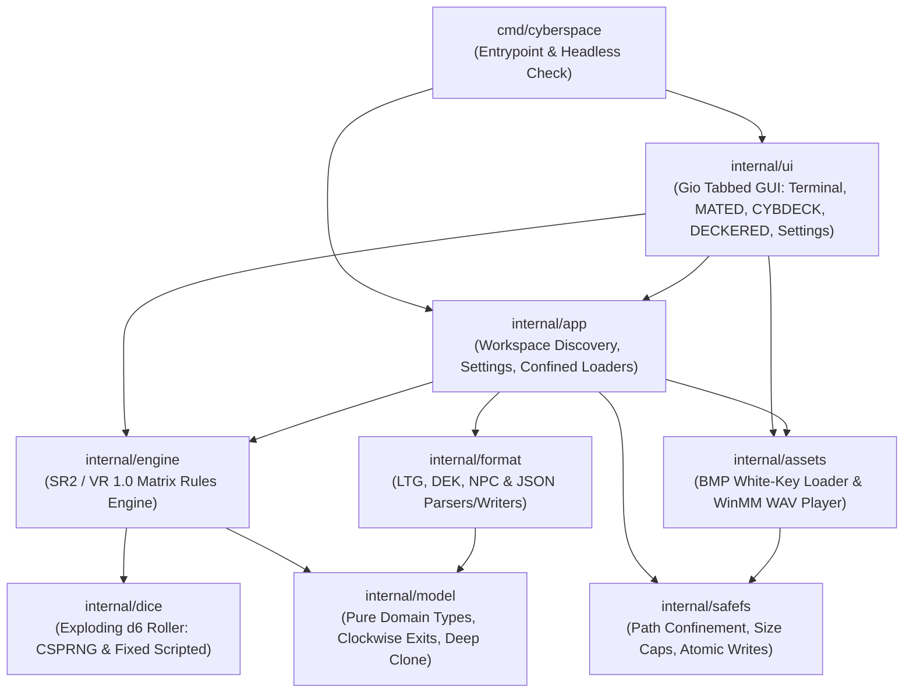

# Architecture Guide — Cyberspace Refactor

## 1. Design Philosophy

**Cyberspace Refactor** follows a strict, layered Clean Architecture in Go so that domain rules, file formats, security boundaries, and GUI rendering remain decoupled, deterministic, and independently testable:

---

## 2. Package Responsibilities

| Package | Responsibility | I/O Permitted? |
| :--- | :--- | :--- |
| [`internal/model`](../internal/model/model.go) | Pure domain structs (`Matrix`, `Node`, `ICE`, `File`, `Deck`, `Persona`, `Utility`, `Decker`), clockwise exit ordering starting at 6 o'clock (`Exits`), and deep `Clone()`. | **No** |
| [`internal/dice`](../internal/dice/dice.go) | Shadowrun "Rule of Six" exploding d6 roller with `MaxExplosions = 50`, `crypto/rand` default source, and deterministic `Fixed` source for unit testing. | **No** |
| [`internal/format`](../internal/format/ltg.go) | Tolerant Windows-1252/UTF-8 INI parser and serializers for `.ltg`, `.dek`, `.npc`, and `.json`, plus `FixLinks` reciprocal dataline repair. | **No** (operates on `[]byte`) |
| [`internal/engine`](../internal/engine/session.go) | Complete Shadowrun 2nd Ed / VR 1.0 Matrix simulation: ranges (`2`/`1`/`0`), ICE state machine, mobile ICE BFS pathfinding, Trace countdowns, Utilities, all 16 System Operations, Hacking Pool (`PoolOriginal` & `PoolSR2Core`), Karma Pool, and `LNK` grid transitions. | **No** (uses injectable `Loader` callback) |
| [`internal/safefs`](../internal/safefs/safefs.go) | Security boundary for all filesystem operations: confines paths under `assets/`, blocks traversal/symlinks/UNC/ADS/reserved names, enforces byte caps, and performs atomic writes with `.bak` backups. | **Yes (Confined)** |
| [`internal/assets`](../internal/assets/library.go) | Resolves legacy `<TYPE><RANGE>[S].BMP` and `IC*.BMP` sprite names, applies `#FFFFFF` transparency keying for ICE overlays, validates BMP header dimensions (`<= 2048×2048`), and plays `.wav` sounds asynchronously via `winmm.dll` (`PlaySoundW`). | **Yes (via `safefs`)** |
| [`internal/app`](../internal/app/app.go) | Locates `assets/`, manages `settings.json`, exposes confined load/save operations, and restricts session log exports (`.txt`/`.log`) to `assets/LOGS/`. | **Yes (via `safefs`)** |
| [`internal/ui`](../internal/ui/shell.go) | Pure-Go hardware-accelerated GUI built with [Gio (`gioui.org`)](https://gioui.org), hosting all 5 modules in a single tabbed window. | **GUI Events Only** |

---

## 3. Simulation Engine State Machine

### 3.1 Node Ranges
Every node is approached through three discrete ranges:
1. **Range 2 (`Observation`)**: Entered upon arriving at a node. The decker sees the node's outer structure; `ever`-triggered ICE activates.
2. **Range 1 (`Sensor`)**: Entered after pressing **Forward** once. Utilities can be executed against ICE from here.
3. **Range 0 (`Contact`)**: Entered after pressing **Forward** a second time (blocked if an undefeated `Access` or `Barrier` ICE is still guarding the node). System Operations can only be performed at **Contact** range. Pressing **Forward** at Range 0 advances along the selected dataline exit to the next node (or transitions to another `.ltg` if the current node is `LNK`).

### 3.2 ICE Lifecycle States
Each ICE instance (`engine.ICEInst`) transitions through:
- `StIdle`: Installed on node, waiting for trigger condition (`ever`, `passive`, `active`, `trigger`).
- `StAsking`: Access ICE demanding identification at Range 1/0 (can be satisfied by `Deception` or bypassed by `Sleaze`).
- `StDeceived`: Access ICE fooled by `Deception` (treated as passed).
- `StSleazed`: Bypassed stealthily by `Sleaze` (unaware of the decker unless attacked or triggered by a failed System Operation).
- `StSuspicious`: Probe/Trace ICE probing the decker's `Masking` before raising an alert.
- `StYelling`: Alerted and actively attacking each action phase (`White` alerts system, `Gray` attacks deck/MPCP/Persona, `Black` inflicts lethal/stun biofeedback against the decker).
- `StCrashed`: Defeated during the current run.

---

## 4. Extending Cyberspace Refactor

- **Adding New Utilities**: Register the utility name, `UtilKind`, and `Degrade` behavior in `utilCatalog` in [`internal/engine/rules.go`](../internal/engine/rules.go), then add its execution case in [`internal/engine/utility.go`](../internal/engine/utility.go) and size multiplier in [`internal/ui/editors.go`](../internal/ui/editors.go).
- **Adding New System Operations**: Add the `Op` enum in [`internal/engine/sysop.go`](../internal/engine/sysop.go), list it in `OpsFor(nodeKind)`, and map its sound in [`internal/assets/names.go`](../internal/assets/names.go).
- **Adding Localization**: All UI strings are centralized in [`internal/ui/`](../internal/ui/shell.go) and can be externalized into a locale table without touching `internal/engine` or `internal/format`.
